# Implementation Plan: Solar Irradiance Forecasting App (Option A: NASA POWER Pipeline)

## 1. Overview & Objective
Build a clean, transparent, single-page solar irradiance forecasting application for **Kupang, East Nusa Tenggara** ($-10.17^\circ, 123.67^\circ$).

### The Real-World Goal:
Provide an accurate, mathematically verified solar irradiance forecast for the **latest published date $D$** from NASA POWER, issued at **00:00 WITA** (16:00 UTC), alongside the **actual measured values** for that day. 

By displaying the forecast curve right next to the ground-truth satellite observations, the app provides a powerful, transparent demonstration of the model's accuracy on real data without any distribution shift or sensor mismatch.

Homeowners and solar operators can check the day's expected harvest ($kWh/m^2$), peak generation windows, cloud intermittency risk, and estimated rooftop PV yield.

---

## 2. Core Review Directives (Mandatory)
* **Clear-sky source (the only one that affects numbers):** Use NASA's published `CLRSKY_SFC_SW_DWN` from the dataset for the forecast day (with the historical day-of-year $\times$ hour lookup as fallback). Computing with `pvlib` is avoided because it differs from NASA's clear-sky values that the model was trained on.
* **Labels:** Replace "Live" and "tomorrow" with **"Forecast for [date] · issued 00:00 WITA"** and a **"Data as of [timestamp]"** stamp, with a **"Prototype · baseline model"** badge.
* **Accuracy card:** Show both baselines ("same as yesterday" persistence and "seasonal average" climatology), and explicitly state the results are for the **2025 test year**.
* **Attribution text:** State **"25 years of hourly NASA POWER data (2001 to 2025)"** (training 2001–2023, validation 2024, test 2025).
* **Neighbor order:** N1, N2, and N3 must strictly match the **column order of `selected_dataset.csv`** (rank order: `+0_-2`, `+0_+1`, `+1_+0`).

---

## 3. Data Strategy (Option A: Pure NASA POWER Pipeline)

### Why 100% NASA POWER?
* **Zero Covariate/Distribution Shift:** The LightGBM model was trained on NASA POWER's CERES/MERRA-2 assimilation data. Keeping inputs 100% from NASA POWER guarantees that the input distribution matches the training distribution perfectly.
* **Side-by-Side Validation:** Because date $D$ is already published in the dataset, the app displays the **Forecast Curve** and the **Actual Measured Curve** together on the same graph. Users and evaluators can visually verify the forecast accuracy.
* **Forecast Formulation:**
  - **Forecast Date $D$:** The latest published date where both the preceding 7 days of history and day $D$'s 24-hour target window exist.
  - **Issue Time:** 00:00 WITA on date $D$ ($16:00$ UTC the day before). The model predicts the daylight hours (6–18 hours after the last observation).
  - **Features:** Assembles the 19 features strictly by name (`P_m1..7`, `P_d1..3`, `N1..3_d1/m1/m3`, `clr`, `step`, `doy_sin`, `doy_cos`).
  - **Output:** Multiplies predicted clearness index $\hat{k}_t$ by NASA's clear sky $CLR$ to produce physical irradiance in $W/m^2$ with the $Q_{10} \to Q_{90}$ likely uncertainty range.

---

## 4. Technology Stack

### Backend (Python / FastAPI)
* **Framework:** `FastAPI` + `Uvicorn` (High performance, async REST API).
* **ML / Data:** `lightgbm`, `pandas`, `numpy`.
* **Clear-Sky Baseline:** NASA's exact `CLRSKY_SFC_SW_DWN` (lookup table built from dataset by day-of-year $\times$ hour).
* **Data Store:** NASA POWER dataset buffer (`selected_dataset.csv` / `predictions.csv`).
* **Endpoints:**
  - `GET /api/forecast/latest`: Serves the latest published forecast with measured actuals, summary statistics, and neighbor nodes.
  - `GET /api/metrics`: Serves test-year 2025 benchmark metrics from `metrics.csv`.

### Frontend (React + Bootstrap 5)
* **Build Tool:** Vite + React (in `my-react-app`).
* **UI Framework:** **Bootstrap 5** (`bootstrap` + `bootstrap-icons`).
* **Charting:** **Chart.js** + **`react-chartjs-2`** for the diurnal curve with forecast line, measured line, clear-sky ceiling, and shaded $Q_{10} \to Q_{90}$ likely range ribbon.
* **Architecture:** **Single-page only**, clean, zero-navigation dashboard.

---

## 5. System Architecture

```mermaid
flowchart TD
    subgraph DataSources["Data Tier (100% NASA POWER)"]
        NASAData["NASA POWER Historical & Published Data<br/>(2001–2025 hourly records)"]
        Models["Pre-trained LightGBM Boosters<br/>(lgbm_mean, lgbm_q10, lgbm_q90)"]
        ClearSky["NASA Clear-Sky Provider<br/>(Published CLRSKY / day-of-year x hour)"]
    end

    subgraph Backend["FastAPI Backend (backend/)"]
        Buffer["Data Buffer Manager<br/>(Loads latest published 7-day history + day D)"]
        NASAData --> Buffer
        
        Buffer --> FeatEng["Feature Pipeline<br/>(Builds 19 columns in exact order)"]
        ClearSky --> FeatEng
        FeatEng --> Models
        
        Models --> PostProc["Post-Processing:<br/>• y_hat = kt × CLR<br/>• Measured actuals pairing<br/>• Daily kWh/m² integration<br/>• Peak hour detection<br/>• Outlook ratio (Optimal/Intermittent/Overcast)"]
        
        PostProc --> Cache[("Forecast Store / Cache")]
        Cache --> Endpoints["REST Endpoints:<br/>• GET /api/forecast/latest<br/>• GET /api/metrics"]
    end

    subgraph Frontend["React Single-Page Dashboard (Bootstrap 5)"]
        Endpoints --> Navbar["Navbar: Kupang, 'Data as of' pill, Prototype badge"]
        Endpoints --> Hero["Hero Card: Forecast Date, Daily Harvest (kWh/m²), Peak Hour, Outlook"]
        Endpoints --> Chart["Diurnal Chart: Forecast + Actual Measured + Q10/Q90 Range + Clear-Sky"]
        Endpoints --> Spatial["Multi-Site Grid: Kupang (P) + 3 Neighbor Grid Cells"]
        Endpoints --> PVCalc["Rooftop PV Calculator: kWp Slider → Estimated kWh Generation"]
        Endpoints --> Accuracy["Model Accuracy Card: 2025 Test Results vs Both Baselines"]
    end
```



---

## 6. Directory & File Structure

```text
my-react-app/
├── backend/
│   ├── app.py                  # FastAPI app, CORS, routes & startup loader
│   ├── forecast_engine.py      # 19-feature pipeline & LightGBM quantile inference
│   ├── clear_sky.py            # NASA-consistent clear-sky lookup (day-of-year x hour)
│   ├── check_parity.py         # Parity verification script against predictions.csv (<= 0.1 W/m²)
│   ├── requirements.txt        # fastapi, uvicorn, lightgbm, pandas, numpy, requests
│   └── data_cache/             # Cached forecast JSON
├── src/
│   ├── components/
│   │   ├── Navbar.jsx          # Header with Kupang, "Data as of" pill and Prototype badge
│   │   ├── SolarHeroCard.jsx   # Forecast date, daily harvest (kWh/m²), peak hour & outlook pill
│   │   ├── DiurnalChart.jsx    # Chart.js with Forecast + Actual Measured + Likely Range + Clear-Sky
│   │   ├── NeighborGrid.jsx    # Cards for Kupang and 3 neighbor grid cells with clear-sky index
│   │   ├── PvYieldWidget.jsx   # Interactive slider (kWp) to estimate day's kWh generation (rough)
│   │   └── MetricsCard.jsx     # Model 2025 test-set accuracy vs both baselines (persistence & climatology)
│   ├── App.jsx                 # Single-page container assembling all components
│   ├── App.css                 # Custom styling
│   └── main.jsx
├── package.json
└── vite.config.js
```

---

## 7. Implementation Steps

### Step 1: NASA-Consistent Clear Sky (`backend/clear_sky.py`)
* Construct the empirical lookup table of NASA `CLRSKY_SFC_SW_DWN` by `(day_of_year, hour)` from the dataset.
* Provides identical clear-sky values to the training pipeline without uncalibrated `pvlib`.

### Step 2: Feature Pipeline & Parity Gate (`backend/forecast_engine.py`, `backend/check_parity.py`)
* Implement feature assembly strictly following `data/model/features.txt`:
  `step`, `clr`, `doy_sin`, `doy_cos`, `P_m1`, `P_m3`, `P_m7`, `P_d1`, `P_d2`, `P_d3`, `N1_d1`, `N1_m1`, `N1_m3`, `N2_d1`, `N2_m1`, `N2_m3`, `N3_d1`, `N3_m1`, `N3_m3`.
* Neighbor order strictly matches `selected_dataset.csv` columns (`+0_-2`, `+0_+1`, `+1_+0`).
* Run `check_parity.py` against 10 sample days in `predictions.csv`: verify differences are $\le 0.1\,W/m^2$.

### Step 3: Serving API (`backend/app.py`)
* Expose `GET /api/forecast/latest`:
  - Returns the latest published day forecast.
  - Includes both `forecast_mean_wm2` and `actual_wm2` for daylight hours.
  - Returns $Q_{10} \to Q_{90}$ likely range, clear-sky ceiling, daily total kWh/m², peak hour, outlook ratio, and neighbor cell statuses.
* Expose `GET /api/metrics`:
  - Returns test year (2025) benchmarks from `metrics.csv`.

### Step 4: Bootstrap 5 Single-Page React Frontend
* **Navbar**: Kupang coordinates, "Data as of [timestamp]" pill, and "Prototype · baseline model" badge.
* **Hero Card**: Explicit date: *"Forecast for [Date] · Issued 00:00 WITA"*, expected harvest ($kWh/m^2$), peak window, and Outlook pill.
* **Diurnal Chart (Chart.js)**:
  - **Forecast line** (orange)
  - **Actual measured line** (emerald green / dark slate)
  - **$Q_{10} \to Q_{90}$ shaded "likely range" ribbon**
  - **Clear-sky ceiling** (dashed gray)
* **PV Yield Calculator**: Slider for system capacity (1–50 kWp) with rough estimated kWh generation and clear assumption disclaimers.
* **Multi-Site Spatial Grid**: Visual cards for Kupang and the 3 neighbor cells with their latest clear-sky index.
* **Model Benchmark Card**: 2025 test-year results from `metrics.csv` showing RMSE against **both baselines** (persistence and climatology), plus the measured range coverage (~71%).
* **Footer**: Transparent attribution: *"Inference Engine: LightGBM Multi-Site Quantile Model (trained on 25 years of hourly NASA POWER data (2001 to 2025); training 2001–2023, validation 2024, test 2025)."*

---

## 8. Verification & Launch
1. Run `check_parity.py` to confirm mathematical agreement with `predictions.csv` ($\le 0.1\,W/m^2$).
2. Start FastAPI (`uvicorn app:app --port 8000`) and test `GET /api/forecast/latest`.
3. Confirm `npm run build` succeeds cleanly.
4. Launch `npm run dev` and test responsiveness on mobile (390px) and desktop.
